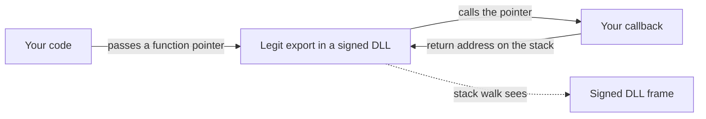
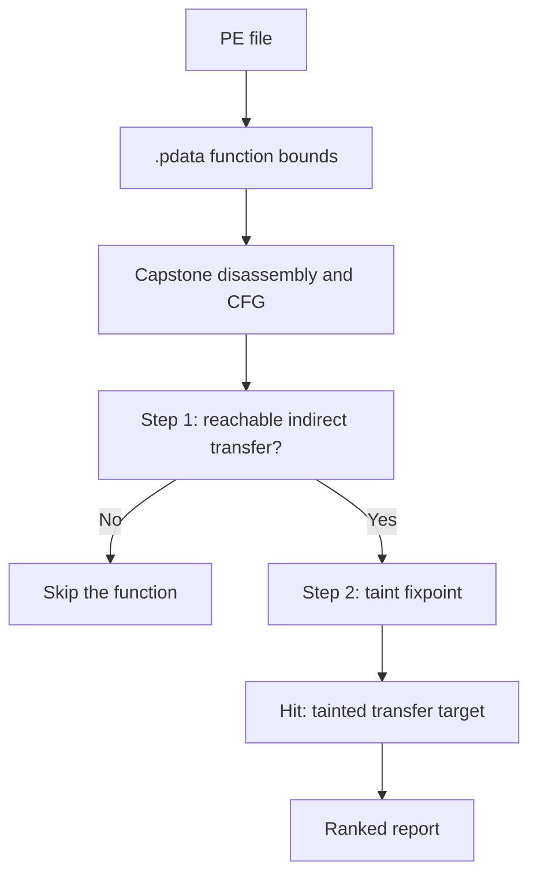
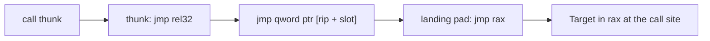

Automating an arguably uncomplicated process to make our lives easier

Stack spoofing, the manual version, goes like this: open a dll, scroll, find a function that calls a pointer it was handed, check which argument holds the pointer, test it, it works (or not...), and then start again with the next one. It is slow in a way that feels weird, because the pattern you are looking for is the same every time. A function takes a pointer in, and somewhere inside it, it calls that pointer.

So I wrote `cbexec` to automate that tedious scrolling for me. Give it a folder of DLLs (system32 is a good start...) and it lists every function that runs a callback it received as an argument. You still have to test the sites yourself of course, but direct callbacks work almost every time. At least you are starting from a list instead of from an empty disassembler.

It builds a CFG for each function and it runs taint analysis over it. That is the whole method.

This post covers what a hit is, how the scanner finds one, the CFG part that took the most work, and how to read the output without drowning in it.

## Why is this useful for anti-analysis?

Upon entering a suspicious function like interacting with memory protection on a region and more, EDRs walk your thread's stack to understand where that call came from. Odds are, if your thread's top frame point to an unbacked, unsigned, R(W)X region... I've got some bad news for your dynamic resilience against EDRs. Each return address within that stack points into a module. When every frame points into a signed DLL, the stack looks normal. That is the entire problem, really. You can have clean code and a clean implant and still get caught by the stack, because the stack is a list of where you came from.

A callback gets around that without faking anything. A legitimate function within a signed module takes your function pointer as an argument and calls it. The return address it pushes sits inside that function, inside a legitimate module. Your code runs, and the stack says a legitimate DLL called something.



*Your code hands a pointer to a legit export. The export calls it back. The return address on the stack belongs to the export.*

For evasion: you do not need a gadget that fakes a stack. That works but it's very complicated to do well and will probably generate more suspicious behavior than not. You need a real function, in a real DLL, that calls the pointer you hand it.

## What counts as a hit

A hit is a function with an indirect `call` or `jmp` whose target came from that function incoming parameter. That is the definition the code uses, and it is worth staying close to it, because everything else follows from it.

According to the x64 Windows ABI, the first four arguments arrive in `rcx`, `rdx`, `r8`, and `r9`. The rest is pushed on the stack, starting at `[rsp+0x28]`. `cbexec` seeds taint from all of them. The four registers, their home slots in the shadow space, and stack arguments 4 through 11. Then it watches where that taint goes. If it reaches the target of an indirect transfer, that transfer is a hit.

There are two tiers of hits, and the difference matters when you go to use one!

`Direct` means the argument value itself is the target. The function calls the pointer it received, with no load in between. `Derived` means the target was loaded or computed through the argument, from a struct field, a vtable entry, or an address built from the argument. The call still runs code the caller supplied, just one step removed. I rank direct first in the report, because those are the ones you know should work. A derived site can work just as well, it just takes more reading to be sure what it will call.

## How it finds them

Function bounds come from your DLL's `.pdata`, the `RUNTIME_FUNCTION` table. I use that because the bounds are exact. No guessing where a function starts from its prologue, no pattern matching for `push rbp` and hoping the next function starts after it!

Each function gets Capstone disassembly and a CFG, and then the scan runs in two phases. I did it this way because running full taint on every function in System32 would take forever, and most functions never call anything indirectly at all.



Step one is syntactic, it walks reachability from the entry, computes CFG leaders, classifies transfers, and checks whether the function contains a reachable indirect transfer. If it does not, the function is skipped. Step two is taint, and it only runs where phase one found a candidate. It is a fixpoint over basic blocks, seeded at the entry with the argument registers and stack slots. Taint moves through `mov`, `lea`, and ALU ops.

The part I spent the most time getting right was the frame tracking, a stack argument is easy to lose track of, because the prologue moves `rsp` around and then the code reads the argument through `rbp` or through a saved pointer register. The analysis tracks `rsp` and `rbp` frame deltas, so a stack argument stays readable after all of that. It also tracks the shape MSVC emits when it does `mov rax, rsp` and then `lea rbp, [rax-0x57]`. If you do not handle that, you lose a lot of stack arguments for no good reason.

Calls clear the volatile registers. `rax`, `rcx`, `rdx`, `r8`, `r9`, `r10`, and `r11`. If a callback pointer only lives in a volatile across a call, it is gone after that call, and the analysis treats it that way. That is conservative, and it will miss some sites, but the alternative is worse, ending up reporting calls that cannot happen, because the register held something else by the time the transfer ran.

There is one rule in here that I want to call out, because it kills a whole class of false positives and it is easy to get wrong: a value loaded from memory counts as derived through an argument only when the base address came from a parameter. A parameter used as an index into static data does not count on its own. Why? A switch jump table and an image thunk both select image content. They are not caller supplied pointers, even when the index came from an argument. Index taint only counts together with a tainted base. I kept tripping over jump tables in early runs, and this was the fix. It is a small rule, and it does most of the filtering.

## Control Flow Guard, or why a naive scanner misses most of it

This is the part that broke a simpler version of the tool, and it is the reason the hit count looks the way it does.

MSVC with `/guard:cf` rewrites `call reg` into a direct call to a shared dispatch thunk:

```
call rel32 ->  thunk: jmp rel32 ... -> jmp qword ptr [rip+slot]
slot (.rdata / .00cfg): <stored VA of a landing pad>
landing pad:           jmp rax
```

Look at that chain for a second. There is no `call reg` left at the call site. There is a direct call to a thunk, and the real target rides in the landing pad register at the call site, in `rax` in the example above. A scanner that only looks for `call reg` misses every one of these sites. On a modern System32 build, that is most of them. I mean that literally. In the run below, 122389 of the 123647 indirect calls are CFG dispatches.



`cbexec` resolves the thunk chain. It follows the jumps, reads the slot, checks that the landing pad ends in `jmp reg`, and reads that register taint at the call site. Those hits carry `; cfg -> reg` in the instruction text and `via=cfg` in the JSON. If you see `via=cfg` in the output, that is what it means. The call site looked direct, and the transfer was indirect one hop later.

Imports look similar at first glance, so the resolver has to tell them apart. An import or GOT slot holds 0, a foreign VA, or a 32-bit RVA. None of those point into the executable section of the image. A CFG slot points at a landing pad inside the image. A stored value that points at an ordinary function fails the `jmp reg` pad test, so it is not mistaken for a dispatch. That check matters, because without it you would start flagging every import call as a callback site, and the list would be useless.

## Reading the output

Here is a run, straight from the README:

```
python3 find_cb_exec.py /path/to/dlls -r -j 8 -o /tmp/out/cbexec
[1/112] acmigration.dll  funcs=1273 icalls=351 hits=146
...
[112/112] wpx.dll  funcs=1552 icalls=6529 hits=2403
CBEXEC_DONE files=112 funcs=114672 icalls=123647 cfg=122389 hits=69735 out=/tmp/out/cbexec
```

112 DLLs, 114672 functions, 123647 indirect calls, 69735 hits. Yes, 69735, it looks like a bug but surprisingly... it is not! Callback shaped functions are everywhere in Windows. That is also why the report ranks the list. Direct tier first, then named functions, then the lowest argument index. Without the ranking, a list that big is just noise.

Take one hit and walk through it, because the JSON is easier to read once you have done that once:

```json
{
  "call": "0x1800011b9", "kind": "call", "form": "reg",
  "tier": "derived", "args": [6], "insn": "call 0x180064010  ; cfg -> rax",
  "bytes": "e8522e0600", "via": "cfg",
  "func": "0x180001150", "fname": "sub_180001150", "fsize": 116,
  "offset": 105, "is_named": false
}
```

The callback sits at `0x1800011b9`, inside function `0x180001150`. That function is 116 bytes long, and the callback is 105 bytes in, so it is near the end. Argument index 6 is the third stack argument. Remember the numbering: 0 is `rcx`, 1 is `rdx`, 2 is `r8`, 3 is `r9`, 4 is the first stack argument, so 6 is the third stack argument. The tier is derived, and the transfer goes through a CFG dispatch thunk, with the target in `rax` at the call site.

Two fields are there for direct use. `offset` is the byte distance from the function entry to the transfer. Jump (NOT CALL) there to skip the prologue. This is extremely important if you supply arguments to whatever you're using your callback for. Odds are, your arguments will get corrupted otherwise. `is_named` is true when the containing function is an export with a real symbol name, and false for a `sub_<va>` label. A named export is easier to call. An unnamed site still works if you can reach it by RVA but it is probably build-specifc and takes more work to get there.

The tool writes four files. `cbexec.jsonl` holds one record per DLL with every hit. `cbexec_hits.tsv` is the same hits as a flat table, with the bytes and disassembly in each row so you can grep it. `cbexec_summary.tsv` holds per DLL counters. `cbexec_report.md` is the grouped report for reading. I use the TSV most of the time, because I am usually filtering for one tier or one argument and I do not want to parse JSON to do that.

## Using a hit

Start with a direct site and a low argument index. Argument 0 in `rcx` is the easiest to supply. A named export in a DLL your process already loads is easier still. You call the export, you pass your function pointer in the right slot, and the export calls it back.

For evasion: the return address on the stack while your callback runs belongs to that export, so a stack walk sees the legitimate DLL. That covers the frames above your callback. It says nothing about what your callback does once it runs, or about the frames your callback creates itself. But this is trivial.

Test each site before you rely on it. A static hit only says the tainted value reaches the transfer. It does not say whether the function is reachable in practice, whether earlier code rejects your argument, or whether the call succeeds with the arguments you pass. The repo is there for that reason. `tests/verify.py` scans `tests/fixture.dll`, a 64-bit build of `tests/fixture.c` with one named direct site and one unnamed derived site, and it compares every hit against `tests/expected.json`. If you change the scanner, run that first. It will tell you if you broke the two shapes that matter.

## The same list, for defense

Flip it around and the output is a watchlist. These are the functions an implant can hide behind. Hook them or log their arguments, and you see the callback pointer at the moment it is handed over.

The size of the list is a problem here too. 69735 hits across 112 DLLs means callback execution cannot be blocked as a shape. Legitimate code does it constantly. So what do you actually look for? A callback argument that points outside any loaded module is a good start. A stack that only looks legitimate because one frame was borrowed is another. And a function that is rarely called with that argument in normal use is worth watching, even if you cannot block it outright, but that might be hard to quantify, I will give you that. Rank by tier, by name, and by argument index, then check what actually shows up at runtime. The static list tells you where to look. It does not tell you what is malicious.

## What it does not do

The analysis is intra-procedural. Taint starts at the function entry and stops at the function boundary. If one function stores a callback in a struct and a second function calls it later, `cbexec` misses the second half. If a callback passes through a helper call in a volatile register, the taint dies at that call by design. I know that loses real sites. I kept it that way because tracking taint across calls would have meant tracking it across the whole program and that is a different tool.

It proves nothing at runtime. Every hit still needs a live test, with the real arguments, in the real process, under your real EDR.

## Build and run

There is not much to it:

```
pip install -r requirements.txt
python3 find_cb_exec.py <dll-or-dir>... [-r] [-j N] [-o DIR]
```

`pefile` and `capstone` are the only dependencies, `-r` recurses into directories, `-j` sets parallel workers with 0 for auto up to 8, and `-o` sets the output directory. Output is byte identical for any `-j`, so a parallel run and a serial run give the same files. `sh tests/build.sh` rebuilds the fixture and its expectation, and it needs `x86_64-w64-mingw32-gcc`.

Have fun with this!
